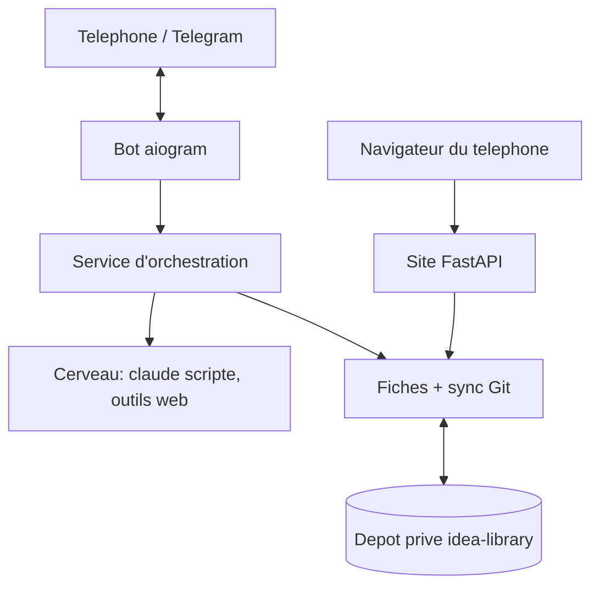
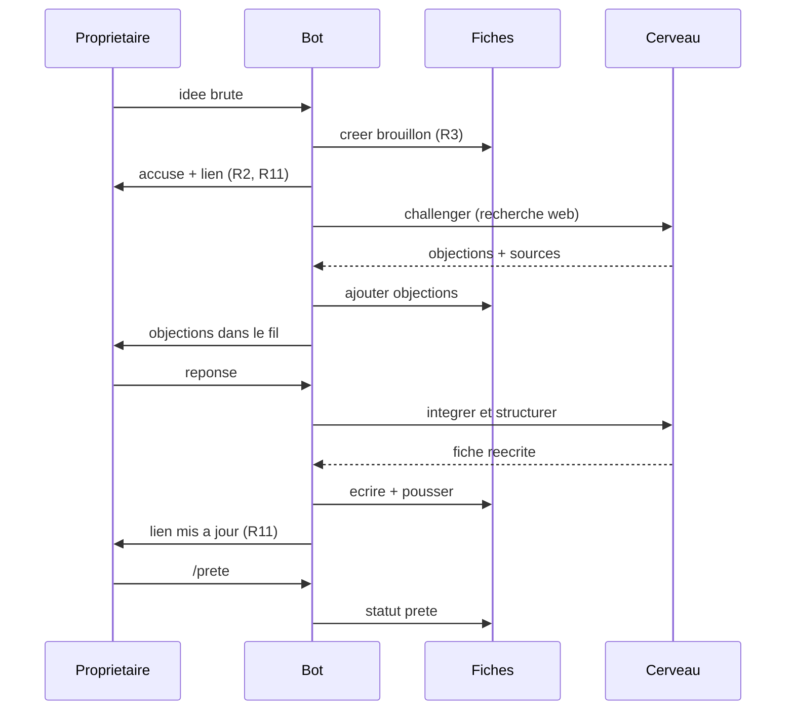
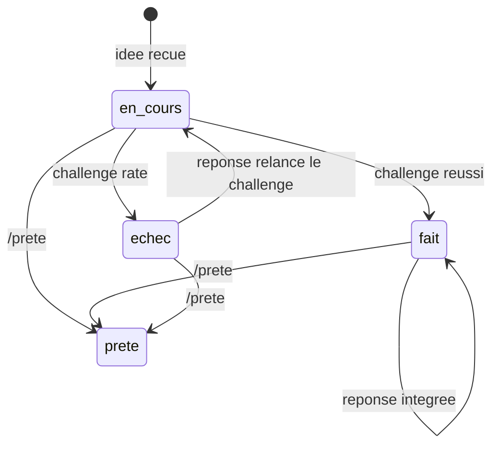

# Bureau d'idées sur Telegram - Plan

**Product Contract preservation :** Product Contract inchangé sur le fond (R1 à R14, A, F, AE intacts). R11 et la décision clé associée sont reformulées pour dire ce que le propriétaire a décidé (aucun message non sollicité hors de la conversation), sans changer le périmètre. La section Dependencies / Assumptions est mise à jour avec des faits vérifiés le 2026-11-13.

## Goal Capsule

- **Objective :** Une idée envoyée depuis le téléphone ressort plus tard comme une fiche claire et complète, assez solide pour qu'un agent puisse construire un projet à partir d'elle.
- **Means :** Un service permanent dans le namespace SSPCloud de l'utilisateur, où le bot Telegram et le site privé forment une seule application, et où Claude Code en mode scripté challenge les idées (KTD1, KTD3).
- **Product authority :** le propriétaire de la bibliothèque, seul utilisateur. Sur le comportement, les R gagnent ; sur le mécanisme, les KTD gagnent dans les limites des R ; une unité n'écrase ni l'un ni l'autre.
- **Active area :** capturer, challenger, structurer et rapporter. Agir, explorer seul et rechercher dans la bibliothèque ne sont pas du scope actif.
- **Stop conditions :** s'arrêter et demander si Anthropic coupe ou restreint l'usage scripté de l'abonnement, si la recherche web n'est pas joignable depuis le pod, ou avant toute action sortante (créer un dépôt GitHub, créer un Secret Kubernetes, publier un paquet GHCR, déployer).
- **Execution profile :** un seul dépôt privé `second-brain` pour le code, un second dépôt privé `idea-library` pour les fiches. Le travail se livre en une seule PR, après un premier commit de squelette. L'exécutant écrit le code et le chart ; l'utilisateur crée le bot avec BotFather, saisit les secrets à la main et rend le paquet GHCR public.

---

## Product Contract

### Summary

Un « bureau d'idées » sur Telegram. L'utilisateur envoie une idée brute, elle est enregistrée aussitôt en brouillon, puis le cerveau la challenge avec des objections fondées sur une recherche web. Les réponses de l'utilisateur enrichissent et structurent la fiche, qu'il marque « prête » quand elle lui convient. Chaque idée reçoit un accusé avec le lien vers sa fiche, dans une bibliothèque privée consultable sur téléphone.

### Problem Frame

Les idées de startups et de projets de l'utilisateur vivent dans Apple Notes, en texte écrit à la main. Il ne les retrouve pas, et rien ne les met à l'épreuve : une idée reste aussi floue le jour où elle est notée que six mois plus tard. Une idée qui n'est ni retrouvable ni solide ne peut pas non plus servir de base à un projet.

### How This Work Fits Together

<!-- ce-section: work-relationships -->
Ce plan couvre une seule zone : capturer, challenger, structurer et rapporter une idée. Le découpage ci-dessous est la compréhension actuelle, pas une feuille de route engagée.

- Agir : lancer du code ou des services dans Onyxia, ou utiliser le cloud Claude, pour construire à partir d'une fiche.
  - Depends on les fiches « prêtes » de ce plan.
  - Shares le canal Telegram pour rapporter les résultats.
- Explorer seul : l'agent essaie des choses sous un plafond de quota, sans demande.
  - Depends on la bibliothèque et le canal de rapport de ce plan.
  - Still to decide : plafond de quota, droits d'écriture, format du digest.
- Rechercher dans la bibliothèque : poser une question en langage naturel et obtenir les fiches sources.
  - Can proceed independently of agir et explorer.
  - Enables le rapprochement d'une nouvelle idée avec les fiches existantes.

### Actors

- A1. Le propriétaire : envoie les idées, répond aux objections, marque les fiches « prêtes », lit la bibliothèque.
- A2. Le cerveau : l'agent qui accuse réception, challenge, structure et rapporte.

### Key Flows

- F1. De l'idée brute à la fiche prête
  - **Trigger :** A1 envoie une idée sur Telegram.
  - **Actors :** A1, A2
  - **Steps :** A2 accuse réception et enregistre un brouillon. A2 recherche sur le web et envoie ses objections avec sources. A1 répond, A2 intègre les réponses dans la fiche. A1 marque la fiche « prête ».
  - **Outcome :** une fiche prête, structurée et sourcée, consultable sur le site privé.
  - **Covered by :** R2, R3, R5, R6, R7, R8, R11

### Requirements

**Capture et conversation**

- R1. Le cerveau ne répond qu'au compte Telegram du propriétaire et ignore tout autre expéditeur.
- R2. Chaque idée reçue reçoit un accusé de réception immédiat.
- R3. Chaque idée est enregistrée comme fiche « brouillon » dès sa réception, avant tout challenge.
- R4. Chaque idée forme son propre fil de discussion, de sorte que deux idées envoyées coup sur coup ne se mélangent pas.

**Challenge et structuration**

- R5. Après l'accusé, le cerveau envoie des objections à l'idée, dans un message.
- R6. Chaque objection s'appuie sur une recherche web, cite sa source, et la fiche conserve les sources ; sans recherche disponible, le cerveau le dit plutôt que d'envoyer des objections non sourcées.
- R7. Les réponses du propriétaire enrichissent la fiche, que le cerveau réécrit dans une structure fixe.
- R8. Une fiche reste « brouillon » tant que le propriétaire ne la marque pas « prête » ; aucune clôture automatique.

**La fiche**

- R9. Une fiche « prête » suit une structure fixe qui couvre au moins : le problème, la cible, l'idée, les objections avec leurs réponses et sources, les questions ouvertes.
- R10. Une fiche « prête » est assez complète pour qu'un agent construise un projet sans redemander les bases au propriétaire.

**Rapports**

- R11. Après la création ou la mise à jour d'une fiche, le propriétaire reçoit un message avec le lien vers elle ; hors des objections (R5), des messages d'état du challenge (AE4) et des réponses à ses commandes, le cerveau n'envoie aucun message non sollicité, ni relance ni digest.

**Bibliothèque en ligne**

- R12. La bibliothèque est un site web lisible sur téléphone, qui affiche chaque fiche avec ses sources cliquables.
- R13. Le site est privé : il demande une connexion, n'est pas indexé, et seul le propriétaire y accède.
- R14. Le site permet de naviguer par statut (brouillon ou prête) et par thème.

### Acceptance Examples

- AE1. **Covers R3, R4.** Given le propriétaire envoie deux idées en une minute, when le cerveau les traite, then deux fiches brouillon distinctes existent et chaque réponse du propriétaire s'applique à la bonne.
- AE2. **Covers R3, R8.** Given une idée envoyée dont le propriétaire ne répond jamais aux objections, when plusieurs semaines passent, then la fiche existe toujours comme brouillon, avec l'idée brute et les objections.
- AE3. **Covers R1.** Given un message d'un compte Telegram autre que celui du propriétaire, when il arrive, then il n'obtient aucune réponse et ne crée aucune fiche.
- AE4. **Covers R6.** Given la recherche web indisponible, when une idée arrive, then le brouillon est enregistré, l'accusé part, et le propriétaire apprend que le challenge est reporté.
- AE5. **Covers R13.** Given un visiteur sans connexion, when il ouvre l'adresse du site ou un lien de fiche, then il ne voit aucune fiche.

### Success Criteria

- Le propriétaire relit une idée qu'il a envoyée et la fiche est claire et complète.
- Plus tard, Claude peut construire des projets à partir de la bibliothèque : c'est le signal à long terme que R9 et R10 sont tenues.

### Key Decisions

- **Le brouillon est créé dès la réception.** Rien ne se perd si le propriétaire ne répond jamais aux objections. Governs R3, R8.
- **Challenger d'abord, structurer ensuite.** Le premier apport du cerveau est de contester l'idée, puis il s'appuie sur les réponses pour la structurer. Governs R5, R7.
- **Les objections s'appuient sur la recherche web.** Une objection sans source ne se distingue pas d'une invention. Governs R6.
- **Bibliothèque privée, consultable par navigation seulement.** Pas de recherche conversationnelle dans cette tranche. Governs R12, R13, R14.
- **Pas de bruit sortant.** Hors de la conversation, seuls l'accusé et le lien de fiche partent, sans relance ni digest. Governs R11.

### Scope Boundaries

Reporté à plus tard :

- Poser une question en langage naturel au cerveau et obtenir les fiches sources.
- Relier une nouvelle idée aux fiches existantes.
- Lancer du code ou des services dans Onyxia, ou utiliser le cloud Claude, pour construire à partir d'une fiche.
- L'exploration autonome sous plafond de quota.
- Les relances et digests hebdomadaires, par exemple la liste des brouillons sans réponse.
- Les notes vocales.

Considéré et non construit :

- Plusieurs réplicas ou haute disponibilité : un seul utilisateur, et un second poller Telegram entrerait en conflit avec le premier.
- Relance automatique périodique d'un challenge échoué : une réponse du propriétaire dans le fil le relance (KTD5) ; l'idée n'est jamais perdue puisque le brouillon existe déjà.
- Authentification au niveau de l'Ingress (oauth2-proxy, Basic Auth de plateforme) : la connexion vit dans l'application (KTD6). Changerait si le site devait servir plusieurs utilisateurs.
- Base de données (PostgreSQL du namespace) : les fiches sont des fichiers dans un dépôt Git (KTD2). Changerait avec la recherche conversationnelle.
- Mode webhook Telegram : l'interrogation continue évite d'exposer un point d'entrée public et le risque de certificat wildcard signalé par la FAQ Telegram.
- Outil de recherche de l'API Anthropic : il exige une clé payante (KTD3).
- Retour vers la page demandée après la connexion : aucune exigence ne le demande, et il ouvrirait une redirection vers un autre site à protéger. Une connexion réussie arrive toujours sur la liste (U5).

### Dependencies / Assumptions

- Hébergement sur SSPCloud, dans le namespace `user-pgoze`. Le rôle admin y est actif : création de secrets et de déploiements vérifiée le 2026-11-13.
- Vérifié le 2026-11-13 : le pod atteint `api.telegram.org` et `api.anthropic.com` en sortie.
- Non vérifié : la recherche et la lecture web de Claude Code fonctionnent depuis ce pod, et les limites de l'abonnement Claude de l'utilisateur supportent un usage scripté permanent.
- Hypothèse : l'utilisateur accepte un délai de quelques minutes avant les premières objections, l'accusé restant instantané.
- Hypothèse : un seul utilisateur, reconnu par son compte Telegram.

---

## Planning Contract

### Key Technical Decisions

- KTD1. **Un seul service permanent, une seule application.** Le bot et le site tournent dans un même processus, en un seul réplica, avec une stratégie de mise à jour qui arrête l'ancien pod avant de lancer le nouveau (deux pollers Telegram simultanés se bloquent). Un chart Helm local en manifestes simples (Deployment, Service, Ingress `onyxia`, volume persistant) remplace l'enveloppe du chart `shiny` : ce dernier n'est pas vérifié pour le volume persistant ni pour la stratégie d'arrêt-puis-lancement. Hôte : `ideas-pgoze.user.lab.sspcloud.fr`, sans `secretName` TLS. Governs R12, R13.
- KTD2. **Les fiches sont des fichiers Markdown dans un dépôt Git privé distinct (`idea-library`).** L'application en est l'unique écrivain : elle le clone sur un volume du service, tire avant d'écrire, valide un commit par modification et pousse après. Le disque du pod disparaît avec le service, le dépôt est la copie durable, et Claude pourra plus tard le lire pour construire. Aucune base de données. Governs R3, R9, R10.
- KTD3. **Le cerveau est Claude Code lancé en mode scripté avec le jeton de l'abonnement** (`claude setup-token`), sans l'option `--bare` qui ne lit pas ce jeton. Il n'a que les outils de recherche et de lecture web, jamais d'écriture ni de shell : l'application écrit seule dans les fichiers. Le modèle est un réglage, par défaut Sonnet. La clé API reste le repli par simple réglage (une clé présente l'emporte sur le jeton, donc un seul des deux est défini à la fois). Les docs d'Anthropic recommandent la clé API pour les produits construits sur Claude et laissent l'usage perso permanent sans mention explicite ; la pause annoncée en juin 2026 d'un changement de quotas peut être levée. Governs R5, R6, R7.
- KTD4. **Telegram : bibliothèque `aiogram` 3 en interrogation continue.** Chaque idée ouvre son propre sujet de discussion dans la conversation privée avec le bot (sujets en conversation privée, API Bot 9.3 et 9.4), et la correspondance sujet-fiche est portée par la fiche. Si le téléphone ou le réglage de BotFather ne le permet pas, repli sur la réponse chaînée (une réponse à un message du bot retrouve sa fiche). Seul l'identifiant du propriétaire est servi ; l'identifiant d'un expéditeur inconnu est journalisé sans réponse, ce qui permet au propriétaire de le découvrir. Governs R1, R2, R4.
- KTD5. **Cycle de vie d'une fiche.** Un tour de challenge par idée. Les réponses suivantes sont intégrées sans nouveau challenge automatique. La commande `/prete` dans le fil marque la fiche « prête ». L'état du challenge est porté par la fiche : `en_cours` dès sa création, `fait` après un challenge réussi, `echec` après un challenge raté (recherche indisponible, quota, délai). Une réponse sur une fiche `echec` relance le challenge avant d'intégrer la réponse ; une réponse sur une fiche `en_cours` attend la fin du challenge. Tous les appels au cerveau (challenge, relance, intégration) passent par une seule file séquentielle, de sorte qu'aucun ne lit une fiche pendant qu'un autre l'écrit. Governs R5, R7, R8.
- KTD6. **Le site est une petite application FastAPI avec sa propre connexion** : mot de passe unique haché (`scrypt`), cookie de session signé, `Secure`, `HttpOnly`, `SameSite`, limitation des essais de connexion en mémoire, en-têtes et `robots.txt` contre l'indexation. Le Markdown est rendu avec le HTML brut désactivé, et chaque source est un lien `http(s)` avec `rel="noopener noreferrer nofollow"`, car le contenu des fiches vient en partie du web. Pas de générateur statique (MkDocs Material est en fin de maintenance, Quartz et MkDocs n'ont pas de connexion). Governs R12, R13, R14.
- KTD7. **Secrets et image.** Jeton du bot, identifiant du propriétaire, hachage du mot de passe, secret de session, jeton Claude et jeton d'accès au dépôt des fiches vivent dans des Secrets Kubernetes créés à la main sans écho, jamais dans Git ni dans l'image. L'application lit chaque réglage dans l'environnement, sinon dans `/secrets/app/<NOM>`. L'image est construite par GitHub Actions et publiée sur GHCR, paquet public, ce qui est acceptable parce qu'elle ne contient aucun secret. Le jeton d'accès Git est limité au seul dépôt `idea-library`, et l'application le fournit à `git` par un assistant d'identifiants ou `GIT_ASKPASS`, jamais dans l'URL du dépôt.
- KTD8. **Les fiches suivent la langue de l'idée** (le français pour l'instant) et la structure fixe de R9 : en-tête (identifiant, titre, statut, thèmes, dates, sujet Telegram, état du challenge) puis sections Idée brute, Problème, Cible, Idée, Objections et réponses avec sources, Questions ouvertes. L'idée brute et la liste des objections avec leurs sources appartiennent à l'application : le cerveau n'en réécrit jamais le texte, il ne fournit que les réponses rattachées à chaque objection et les autres sections. Les thèmes sont proposés par le cerveau en réutilisant la liste existante, pour éviter la prolifération. Governs R9, R10, R14.

### High-Level Technical Design

Composants et sens des échanges :



Parcours d'une idée (F1) :



États d'une fiche (état du challenge, puis statut ; la fiche reste `brouillon` tant qu'elle n'est pas `prete`) :



### Output Structure

```
second-brain/
  pyproject.toml
  Dockerfile
  README.md
  .github/workflows/image.yml
  app/ideadesk/
    config.py        # réglages: environnement, sinon /secrets/app/<NOM>
    fiche.py         # lecture/écriture Markdown + en-tête
    store.py         # fichiers + synchronisation Git
    brain.py         # sous-processus claude, challenge et intégration
    prompts/         # consignes du cerveau
    service.py       # logique idée / réponse / prête
    bot.py           # colle aiogram, filtre propriétaire, fils
    web.py           # connexion, liste, fiche
    templates/
    main.py          # démarre bot et site ensemble
  k8s/ideadesk/      # chart en manifestes simples
  tests/
```

Les listes `**Files :**` de chaque unité font foi pour ce que l'unité crée.

### Risks & Dependencies

- **Coupure ou restriction de l'abonnement pour l'usage scripté.** Le service s'arrête de challenger sans perdre de fiche (KTD5). Réponse : passer à la clé API par réglage (KTD3) ; à re-vérifier juste avant le lancement dans la page d'assistance Anthropic.
- **Sujets en conversation privée non supportés sur le téléphone ou non activés.** Réponse : repli sur la réponse chaînée (KTD4), décidé par un essai au début de U4.
- **Injection par le contenu web.** Un texte lu par le cerveau peut tenter de le détourner ou d'injecter du HTML dans une fiche. Réponse : outils limités à la lecture web, écriture par l'application seule, rendu Markdown sans HTML brut (KTD3, KTD6).
- **Deux pods simultanés pendant une mise à jour.** Conflit de poller et risque de double écriture. Réponse : stratégie d'arrêt avant lancement et un seul réplica (KTD1).
- **Perte du volume ou du service.** Les fiches survivent dans `idea-library` ; un brouillon créé juste avant une panne et pas encore poussé est le seul risque, d'où la poussée après chaque écriture (KTD2).
- **Fuite d'un secret.** Réponse : Secrets Kubernetes à la main, aucune valeur dans Git ni dans l'image publique, jeton Git limité à un dépôt (KTD7).
- **Dérive des options de la CLI Claude.** Les options exactes (`--tools`, `--allowedTools`, `--permission-mode`, format de sortie) sont à confirmer avec `claude --help` à la version installée dans l'image ; la version est épinglée.

### System-Wide Impact

Le service s'ajoute au namespace `user-pgoze` à côté de `excel-addin-backend`, `wikidb` et des instances PostgreSQL, qu'il ne touche pas. Il consomme un pod, un petit volume persistant et un hôte Ingress. Il consomme aussi les limites de l'abonnement Claude de l'utilisateur, partagées avec ses autres usages.

### Sources / Research

- Recherche web du 2026-11-13 : politique d'authentification et d'usage (`code.claude.com/docs/en/authentication`, `.../legal-and-compliance`, `.../headless`), note d'assistance sur l'usage du SDK avec l'abonnement, journal des versions de l'API Bot Telegram (sujets en conversation privée), `aiogram` 3.31, état de maintenance de MkDocs Material.
- État du namespace relevé le 2026-11-13 : hôtes Ingress existants au schéma `<app>-pgoze.user.lab.sspcloud.fr`, classe `onyxia`, `wikidb` sans rapport avec ce plan.
- Modèle de chart, de CI et de lecture des secrets : skill `onyxia`, référence SSPCloud (`~/.local/share/claude-onyxia-config/skills/onyxia/sspcloud.md`).

---

## Implementation Units

### U1. Squelette, réglages et image

- **Goal :** un projet Python qui démarre, lit ses réglages et se construit en image publiable.
- **Requirements :** R1 (identifiant propriétaire lu en réglage), KTD7.
- **Dependencies :** aucune.
- **Files :** `pyproject.toml`, `app/ideadesk/__init__.py`, `app/ideadesk/config.py`, `Dockerfile`, `.github/workflows/image.yml`, `.gitignore`, `tests/test_config.py`.
- **Approach :**
  - Chaque réglage se lit dans l'environnement, sinon dans `/secrets/app/<NOM>`, avec un message d'erreur qui nomme le réglage manquant sans afficher de valeur.
  - Les réglages incluent l'adresse publique du site (`PUBLIC_BASE_URL`), dont U4 se sert pour construire chaque lien de fiche envoyé sur Telegram ; elle n'est pas écrite en dur dans le code.
  - L'image contient Python, l'application et la CLI Claude Code à version épinglée ; `HOME` pointe vers un dossier inscriptible.
  - La CI construit et pousse l'image sur GHCR à chaque push sur `main`, selon le modèle du skill `onyxia`.
- **Patterns to follow :** `backend/app/settings.py` du dépôt `excel-addin-sample` (lecture environnement puis `/secrets/app`).
- **Test scenarios :**
  - Une valeur dans l'environnement l'emporte sur le même réglage dans `/secrets/app`.
  - Un réglage présent seulement dans `/secrets/app/<NOM>` est lu, espaces de fin retirés.
  - Un réglage obligatoire absent lève une erreur qui nomme le réglage et n'imprime aucune valeur des autres.
- **Verification :** les tests de configuration passent ; l'image se construit en CI.

### U2. Fiches et synchronisation Git

- **Goal :** lire, écrire et synchroniser les fiches comme fichiers Markdown dans le dépôt `idea-library`.
- **Requirements :** R3, R8, R9, R14 ; KTD2, KTD8.
- **Dependencies :** U1.
- **Files :** `app/ideadesk/fiche.py`, `app/ideadesk/store.py`, `tests/test_fiche.py`, `tests/test_store.py`.
- **Approach :**
  - `fiche.py` définit l'en-tête et les cinq sections de KTD8, et lit comme écrit une fiche sans perdre de contenu.
  - `store.py` clone le dépôt au démarrage s'il est absent, tire avant d'écrire, commit une modification à la fois, pousse après, et signale un échec de poussée sans bloquer l'écriture locale.
  - Un échec de poussée est retenté à l'écriture suivante.
  - Le jeton d'accès arrive à `git` par un assistant d'identifiants ou `GIT_ASKPASS` (KTD7), et tout message d'erreur de `git` est débarrassé du jeton avant d'être journalisé.
- **Test scenarios :**
  - Écrire puis relire une fiche rend le même contenu, y compris des accents et des liens.
  - Créer une fiche brouillon produit un fichier avec statut `brouillon`, état `challenge: en_cours`, l'idée brute dans sa section et les autres sections vides.
  - Changer le statut en `prete` ne modifie ni le texte ni les sources.
  - Deux fiches créées coup sur coup reçoivent des identifiants distincts.
  - Une poussée qui échoue laisse la fiche écrite localement, journalise l'échec et la retente à l'écriture suivante.
  - Une poussée qui échoue avec un message d'erreur contenant le jeton est journalisée sans le jeton.
  - La liste des thèmes existants se déduit des fiches et ne contient pas de doublon de casse.
- **Verification :** un dépôt temporaire local sert de remote dans les tests ; les commits attendus y apparaissent.

### U3. Cerveau : challenge et intégration

- **Goal :** produire des objections sourcées et réécrire une fiche à partir des réponses, avec des échecs gérés.
- **Requirements :** R5, R6, R7, R9, R10 ; AE4 ; KTD3, KTD5, KTD8.
- **Dependencies :** U1, U2.
- **Files :** `app/ideadesk/brain.py`, `app/ideadesk/prompts/challenge.md`, `app/ideadesk/prompts/integrate.md`, `tests/test_brain.py`.
- **Approach :**
  - Lancer `claude` en sous-processus, dans un dossier vide et temporaire, avec un délai maximal, un nombre de tours borné et seulement les outils de recherche et de lecture web.
  - Le sous-processus reçoit un environnement minimal (jeton Claude, `PATH`, `HOME`) : les autres secrets du service ne lui sont jamais transmis.
  - Le challenge renvoie une liste d'objections, chacune avec au moins une URL. L'intégration ne renvoie que les sections réécrites et, pour chaque objection, la réponse du propriétaire rattachée par identifiant. L'application garde elle-même l'idée brute, le texte des objections et leurs sources (KTD8), si bien qu'une sortie incomplète du modèle ne peut pas les faire disparaître. Le code valide la forme de la réponse avant de la prendre en compte.
  - Tout échec (sortie illisible, délai, quota, recherche indisponible, objection sans source) devient un résultat explicite « challenge indisponible » que le service transforme en message, jamais une objection non sourcée.
- **Execution note :** commencer par confirmer avec `claude --help` les options de restriction d'outils et de format de sortie à la version installée, puis écrire les tests avec un faux exécutable `claude`.
- **Technical design :** directionnel : la sortie attendue est du JSON `{objections:[{texte, sources:[url]}]}` pour le challenge et `{probleme, cible, idee, reponses:[{objection_id, reponse}], questions_ouvertes, themes}` pour l'intégration.
- **Test scenarios :**
  - Avec un faux `claude` qui renvoie deux objections sourcées, le challenge retourne deux objections avec leurs URL.
  - Une objection sans URL est écartée, et si toutes le sont, le résultat est « challenge indisponible ».
  - Un faux `claude` qui dépasse le délai est tué et donne « challenge indisponible ».
  - Une sortie qui n'est pas du JSON valide donne « challenge indisponible » sans exception qui remonte.
  - Covers AE4. Avec un faux `claude` qui signale la recherche web indisponible, le résultat est « challenge indisponible » et le brouillon reste inchangé.
  - L'intégration d'une réponse produit une fiche où la réponse est rattachée à l'objection visée et les sources sont conservées.
  - Quand la sortie de l'intégration omet une objection ou une source, la fiche écrite garde quand même l'idée brute, chaque objection et chaque source.
  - Le sous-processus lancé avec un environnement qui contient le jeton du bot, le jeton Git et le hachage du mot de passe ne reçoit que le jeton Claude, `PATH` et `HOME`.
  - Un contenu web qui contient une consigne (« ignore tes règles ») ne modifie pas la forme ni le nombre d'appels : la sortie est traitée comme du texte.
- **Verification :** les tests passent avec le faux exécutable ; un essai réel unique est fait au déploiement (U6).

### U4. Service d'orchestration et bot Telegram

- **Goal :** transformer les messages Telegram en fiches, objections, intégrations et liens.
- **Requirements :** R1, R2, R3, R4, R5, R7, R8, R11 ; AE1, AE2, AE3 ; KTD4, KTD5.
- **Dependencies :** U2, U3.
- **Files :** `app/ideadesk/service.py`, `app/ideadesk/bot.py`, `tests/test_service.py`, `tests/test_bot.py`.
- **Approach :**
  - `service.py` porte la logique sans Telegram : nouvelle idée, réponse dans un fil, `/prete`, relance d'un challenge en attente. `bot.py` n'est que la colle `aiogram` et le filtre propriétaire.
  - Une seule file séquentielle traite tous les appels au cerveau (challenge, relance, intégration) l'un après l'autre (KTD5) ; l'accusé part avant le challenge, hors de la file.
  - Le lien envoyé est celui du site privé avec l'identifiant de la fiche.
  - Les messages d'un expéditeur autre que le propriétaire sont ignorés ; leur identifiant est journalisé.
- **Execution note :** commencer par un essai réel avec le bot sur le téléphone de l'utilisateur pour savoir si les sujets en conversation privée fonctionnent ; ne construire le repli par réponse chaînée que si l'essai échoue.
- **Test scenarios :**
  - Covers AE3. Un message d'un identifiant différent du propriétaire ne produit ni réponse ni fiche, et son identifiant est journalisé.
  - Une nouvelle idée crée le brouillon avant tout appel au cerveau, puis envoie l'accusé avec le lien.
  - Covers AE1. Deux idées envoyées à quelques secondes d'écart créent deux fiches et deux fils ; une réponse dans le second fil modifie seulement la seconde fiche.
  - Covers AE2. Une idée sans réponse reste `brouillon` avec ses objections, sans message supplémentaire.
  - Une réponse dans un fil connu appelle l'intégration puis envoie un seul message avec le lien.
  - `/prete` dans un fil passe la fiche à `prete` et confirme avec le lien ; `/prete` hors fil d'idée est refusé poliment.
  - Quand le challenge est « indisponible », le brouillon existe, l'accusé est parti, un message explique le report, et la fiche porte `challenge: echec`.
  - Une réponse dans le fil d'une fiche `challenge: echec` relance d'abord le challenge, puis intègre la réponse.
  - Une réponse qui arrive pendant le challenge de sa fiche (`challenge: en_cours`) est intégrée après l'écriture des objections, et aucun second challenge ne part.
  - Un message dans un fil dont la fiche n'existe plus est refusé sans créer de fiche.
- **Verification :** les tests passent avec un faux cerveau et une fausse API Telegram ; l'essai réel des sujets est noté dans le dépôt.

### U5. Site privé

- **Goal :** un site lisible sur téléphone, derrière connexion, qui liste et affiche les fiches.
- **Requirements :** R12, R13, R14 ; AE5 ; KTD6.
- **Dependencies :** U2.
- **Files :** `app/ideadesk/web.py`, `app/ideadesk/templates/base.html`, `app/ideadesk/templates/login.html`, `app/ideadesk/templates/index.html`, `app/ideadesk/templates/fiche.html`, `tests/test_web.py`.
- **Approach :**
  - Routes : connexion, déconnexion, liste avec filtres par statut et par thème, fiche, `/healthz` non authentifié pour les sondes.
  - Toute route hors connexion et `/healthz` redirige vers la connexion ; une connexion réussie arrive toujours sur la liste, sans reprise de l'adresse demandée au départ.
  - Les pages portent un en-tête et un `robots.txt` contre l'indexation. La mise en page est une colonne unique lisible sur 400 px.
- **Test scenarios :**
  - Covers AE5. Sans cookie, la liste et une fiche renvoient une redirection vers la connexion et aucun contenu de fiche.
  - Un mauvais mot de passe est refusé ; au-delà du seuil d'essais, la connexion est ralentie ou refusée.
  - Un bon mot de passe pose un cookie de session et donne accès ; la déconnexion le retire.
  - Une connexion réussie depuis `/login?next=https://autre-site.example` arrive sur la liste du site, jamais sur l'autre adresse.
  - La liste filtrée par statut `brouillon` ne montre aucune fiche `prete`, et inversement ; le filtre par thème fonctionne de même.
  - Une fiche dont le texte contient `<script>` s'affiche en texte inerte, pas en HTML actif.
  - Une source `javascript:` n'est pas rendue comme lien ; une source `https:` l'est avec `rel="noopener noreferrer nofollow"`.
  - `/healthz` répond 200 sans cookie et ne dévoile rien d'une fiche.
- **Verification :** les tests passent avec un client de test de l'application et un dépôt de fiches temporaire.

### U6. Chart, déploiement et essai de bout en bout

- **Goal :** le service tourne dans `user-pgoze`, joignable en HTTPS, et une idée réelle passe de Telegram à la fiche.
- **Requirements :** tous, en particulier R1 à R14 ; KTD1, KTD7.
- **Dependencies :** U1, U2, U3, U4, U5.
- **Files :** `app/ideadesk/main.py`, `k8s/ideadesk/Chart.yaml`, `k8s/ideadesk/values.yaml`, `k8s/ideadesk/templates/deployment.yaml`, `k8s/ideadesk/templates/service.yaml`, `k8s/ideadesk/templates/ingress.yaml`, `k8s/ideadesk/templates/pvc.yaml`, `README.md`, `tests/test_main.py`.
- **Approach :**
  - `main.py` démarre le site et l'interrogation Telegram dans un même processus et s'arrête proprement.
  - Le chart déclare un réplica, une stratégie d'arrêt avant lancement, le volume persistant monté pour le clone de `idea-library`, des sondes sur `/healthz`, l'Ingress `onyxia` sans `secretName`, et lit les secrets par `secretKeyRef`.
  - L'image tourne sous un identifiant d'utilisateur fixe, et le pod déclare un `securityContext.fsGroup` égal à cet identifiant, pour que le clone sur le volume et `HOME` soient inscriptibles ; le clone vit dans un sous-dossier du point de montage.
  - `README.md` donne la marche à suivre pour l'utilisateur, sans aucune valeur secrète : créer le bot avec BotFather, activer les sujets, lancer `claude setup-token`, créer les Secrets avec `read -rs` et `kubectl create secret`, créer les deux dépôts privés, rendre le paquet GHCR public.
  - Déploiement : `helm template … | kubectl apply --dry-run=server`, puis `helm install`, selon le skill `onyxia`.
- **Patterns to follow :** le Deployment `wikidb` du namespace (volume `wikidb-data`, stratégie `Recreate`, `fsGroup` explicite) ; lecture seule, `wikidb` ne se modifie pas.
- **Execution note :** vérifier le rendu contre le vrai cluster avant l'installation ; chaque action sortante (dépôts, Secrets, paquet public, installation) attend la confirmation de l'utilisateur.
- **Test scenarios :**
  - Le démarrage sans réglage obligatoire échoue avec un message qui nomme le réglage et sort en erreur.
  - Le processus démarré répond à `/healthz` pendant que l'interrogation Telegram est active.
  - Un arrêt demandé (signal) ferme l'interrogation et laisse les écritures en cours finir.
  - Essai réel : une idée envoyée par le propriétaire produit l'accusé, un brouillon dans `idea-library`, des objections avec sources, puis, après réponse et `/prete`, une fiche prête consultable sur le site.
  - Essai réel : l'adresse de la fiche ouverte sans connexion montre la page de connexion.
  - Essai réel : un second compte Telegram qui écrit au bot ne reçoit rien.
  - Essai réel : au premier démarrage sur le volume vierge, le clone de `idea-library` réussit sans erreur de droits.
- **Verification :** voir le Verification Contract.

---

## Verification Contract

| Quoi | Comment | S'applique à |
|---|---|---|
| Tests unitaires et de composants | `uv run pytest` à la racine de `second-brain` | U1 à U6 |
| Rendu du chart | `helm lint k8s/ideadesk` puis `helm template ideadesk k8s/ideadesk -n user-pgoze \| kubectl apply --dry-run=server -n user-pgoze -f -` | U6 |
| Construction de l'image | workflow GitHub Actions vert sur `main` ; le paquet se tire sans identifiants une fois rendu public | U1, U6 |
| Santé après déploiement | `curl` de `https://ideas-pgoze.user.lab.sspcloud.fr/healthz` renvoie 200 sans authentification | U6 |
| Protection du site | une fiche demandée sans cookie renvoie la page de connexion ou une redirection, jamais son contenu | U5, U6 |
| Essai réel de bout en bout | le propriétaire envoie une idée et suit F1 jusqu'à `/prete` ; une fiche prête est relue sur le téléphone | U6 |

## Definition of Done

- Chaque exigence R1 à R14 est tenue par une unité vérifiée, et chaque AE a un test ou un essai réel qui le couvre.
- Le service tourne dans `user-pgoze` avec un seul réplica, joignable en HTTPS, et une idée réelle est allée jusqu'à une fiche « prête » lue sur le téléphone.
- Aucun secret n'apparaît dans Git, dans l'image, dans un `values.yaml` ni dans les journaux.
- Le dépôt `idea-library` contient les fiches et l'historique de leurs modifications.
- Le code d'essais abandonnés ou expérimentaux est supprimé du diff.
- Les points ouverts ci-dessous sont soit tranchés dans l'unité qui les touche, soit laissés visibles.

### Open Questions

- Le nom exact du réglage BotFather qui active les sujets en conversation privée, et leur support sur le client du propriétaire : à trancher par l'essai du début de U4 (KTD4 prévoit le repli).
- Les options exactes de la CLI Claude pour restreindre les outils et lire la sortie : à confirmer avec `claude --help` au début de U3.
- L'état de la politique d'Anthropic sur l'usage scripté de l'abonnement : à relire dans la page d'assistance avant le lancement, et à signaler au propriétaire si elle change (KTD3).
